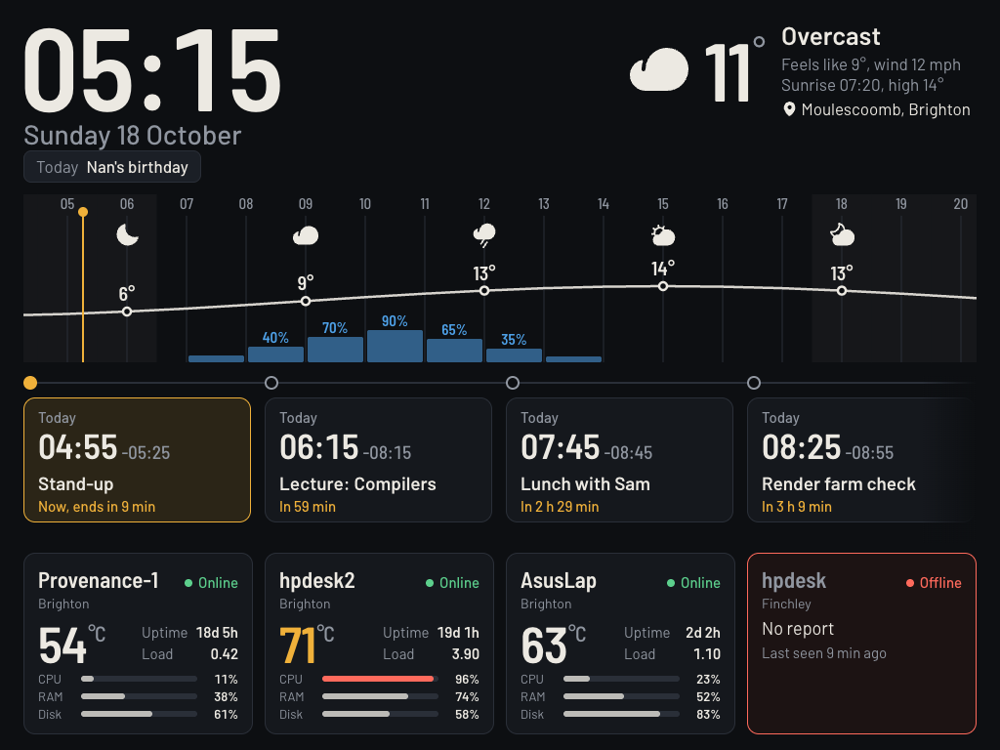

<div align="center">

# iPad Dashboard

**A glanceable wall board for an old iPad: server health, weather, the day's timeline and your next calendar events, on one screen.**

Built for a jailbroken iPad mini 1 (iOS 9.3.5, Safari 9, 1024x768). No build step, no npm, no framework.



<sub>Screenshot uses the built-in <code>--mock</code> data.</sub>

</div>

## Why

An iPad mini 1 is stuck on iOS 9. It cannot do modern TLS, so it cannot open most of today's sites or APIs. This project puts a small Python server on your LAN that talks to the modern internet and serves the iPad one plain-HTTP page it can render.

## What's on the screen

| Area | What it shows |
|---|---|
| Header | Big clock, date, current weather. Tap the weather to search for a new location. |
| All-day chips | All-day calendar events for today. |
| Timeline | A 16 hour weather strip: icons and temperatures every 3 h, rain chance bars, night shading, a "now" line. |
| Event pipeline | Upcoming events as cards on a left-to-right line. Four fit on screen, swipe for more. The next event is outlined in amber and says how long until it starts. |
| Servers | One card per machine: online or offline, CPU temperature, uptime, load, CPU, RAM and disk bars. |

Made for a screen that stays on all day:

- Dims between 23:00 and 06:30 (turn off with `?dim=0`).
- Shifts a few pixels every 5 minutes against image retention.
- Reloads itself every 6 hours.
- Uses the **server's** clock, so a drifting iPad clock never shows the wrong time.
- Shows a banner when it cannot reach the server.

## How it works

```
  machines ──(agent.py, push every 15 s)──▶ ┐
                                             │   server.py   ──▶  iPad (Safari 9)
  hpdesk-style ◀──(server polls /stats)────  │   :8090            polls /api/state
  behind a tunnel                            │
  Open-Meteo (weather) ─────────────────────▶┤
  Google Calendar secret .ics ──────────────▶┘
```

- `server/server.py`: standard-library Python backend. Serves `web/` and the API.
- `agent/agent.py`: standard-library, Linux-only stats agent. Reports uptime, CPU temperature, load, CPU, RAM and disk.
- `web/`: the front end. Plain ES5, written for Safari 9.

## Quick start

Try it with sample data first:

```sh
python3 -m venv .venv && .venv/bin/pip install icalendar recurring-ical-events
.venv/bin/python server/server.py --mock --port 8090
# open http://localhost:8090/
```

Real setup:

1. Copy `config.example.json` to `config.json`. Set a long random `token`, your `timezone`, your `location`, and the `servers` list.
2. Put your Google Calendar **secret address in iCal format** in `ics_url` (Calendar settings, Integrate calendar). Anyone with that link can read your calendar, so keep `config.json` private (it is git-ignored).
3. Run the server: `.venv/bin/python server/server.py --config config.json`.
4. On each machine you want to monitor:
   ```sh
   python3 agent.py --id hpdesk2 --push http://DASHBOARD-HOST:8090 --token YOUR_TOKEN
   ```
   `--id` must match an `id` in `config.json`. A machine counts as offline after 45 s without a report.
5. On the iPad, open `http://DASHBOARD-HOST:8090/` in Safari, then Share, Add to Home Screen for full screen. Guided Access stops it being closed by accident.

Run both as systemd user units with `loginctl enable-linger` to keep them up across reboots.

### A machine you cannot push from

If a machine cannot reach the dashboard (for example it is on another network behind a Cloudflare Tunnel), run the agent in serve mode and let the server pull from it:

```sh
python3 agent.py --serve 9101 --token SECRET        # on that machine, exposed via your tunnel
```

```json
{"id": "hpdesk", "name": "hpdesk", "site": "Finchley",
 "poll": {"url": "https://stats.example.com/stats", "token": "SECRET"}}
```

## API

| Endpoint | |
|---|---|
| `GET /api/state` | Weather, events, servers, calendar status |
| `GET /api/geocode?q=` | Place search for the weather location |
| `POST /api/location` | Change the weather location (kept in `state.json`) |
| `POST /api/report` | Agent report. Needs an `X-Token` header |
| `POST /api/clientlog` | iPad diagnostics, printed to the server log |
| `GET /healthz` | Liveness check |

Weather comes from [Open-Meteo](https://open-meteo.com/) (no key needed) and refreshes every 10 minutes. The calendar refreshes every 5 minutes.

## Writing for Safari 9

If you change `web/app.js` or `web/style.css`, remember what iOS 9 lacks:

- ES5 only. No `fetch`, arrow functions, `let`/`const` or template strings.
- No CSS Grid, no flex `gap`, no `inset`.
- A function declaration inside an `if` block is a syntax error in strict mode. Use `var f = function`.
- `height:100%` inside a flex item resolves to 0. Position the child absolutely instead.
- Fonts must be `woff`, not `woff2`.
- Icons use `xlink:href`.

Check your changes with `npx jshint --config <(echo '{"esversion":5,"strict":"implied","browser":true,"undef":true}') web/app.js`. The page also reports `window.onerror` and a boot log to `/api/clientlog`, which is the easiest way to debug a real iPad.

## Security

This is a LAN tool served over plain HTTP. Keep it off the public internet. Agents authenticate with a shared token and the calendar link is a secret, so keep `config.json` out of git (it is in `.gitignore`).

## Credits

Typefaces: [Barlow](https://github.com/jpt/barlow) (SIL OFL, licence in `web/fonts`). Icons: [Phosphor](https://phosphoricons.com/) (MIT). Weather: Open-Meteo.

## Licence

MIT. See `LICENSE`.
